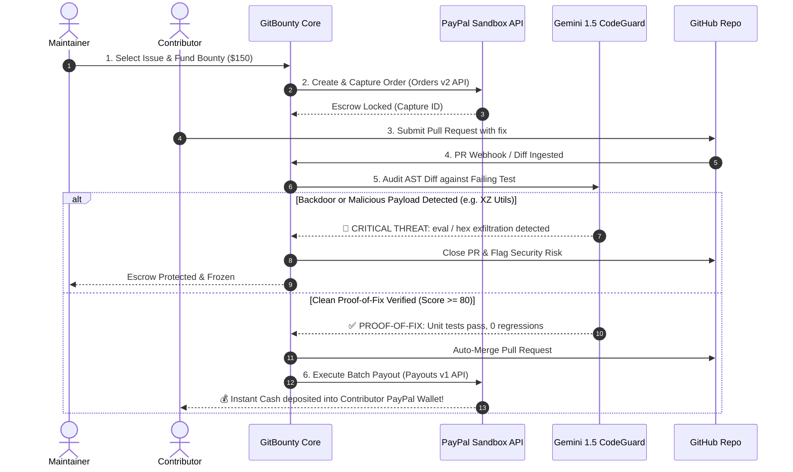

# GitBounty AI 🛡️💰
### Autonomous Open-Source Bug Escrow & Instant PayPal Payouts
**Submission for the PayPal AI Hackathon: Build What's Next with PayPal and AI**

[](LICENSE)
[](https://developer.paypal.com/)
[](https://aistudio.google.com/)
[](https://www.ag-grid.com/)
[](render.yaml)

---

## 📌 The Problem
Open-source bug bounties and freelance development are plagued by two catastrophic bottlenecks:
1. **Maintainer Review Fatigue & Ghosting:** Developers spend days resolving complex bugs, only for pull requests to sit unmerged for months while their bounty payouts are held hostage.
2. **AI-Generated Spam & Supply-Chain Attacks (The XZ Nightmare):** Since the rise of LLMs, repos with cash bounties are flooded with ChatGPT-generated hallucinations and stealth backdoors (eval, obfuscated hex payloads) attempting to steal credentials before collecting payment.

## 💡 The Solution: GitBounty AI
**GitBounty AI** is an autonomous financial protocol that binds **Code Execution directly to PayPal Financial Rails**:
* **PayPal Smart Escrow:** Sponsors and maintainers fund issues upfront using the **PayPal Orders v2 API**, locking bounty funds securely.
* **Gemini CodeGuard:** When a Pull Request is submitted, Gemini 1.5 Flash performs dynamic AST security checks (detecting reverse shells, eval execution, secret exfiltration) and verifies unit tests pass.
* **Instant Automated PayPal Payouts:** The moment a PR achieves mathematical proof-of-fix (score ≥ 80), GitBounty automatically merges the PR and dispatches instant cash directly to the contributor's PayPal email address using the **PayPal Payouts v1 API**.
* **Atomic Multi-Contributor Batch Splits:** When multiple developers collaborate, GitBounty analyzes AST contributions and splits the payout atomically using PayPal Batch Payouts!

---

## 🏗️ Architecture & Pipeline



---

## 🛠️ PayPal Developer Technologies Integrated
* **[PayPal Orders v2 API](https://developer.paypal.com/docs/api/orders/v2/):**
  * Programmatic escrow creation (`POST /v2/checkout/orders`) with capture intent.
  * Instant fund capture (`POST /v2/checkout/orders/{id}/capture`) upon sponsor authorization.
* **[PayPal Payouts v1 API](https://developer.paypal.com/docs/api/payments.payouts-batch/v1/):**
  * Automated batch payouts (`POST /v1/payments/payouts`) directly to contributor email addresses without requiring credit card numbers or banking delays.
  * Multi-contributor split payments executed simultaneously in a single atomic transaction.
* **[PayPal Webhooks v1 API](https://developer.paypal.com/docs/api/webhooks/v1/):**
  * Event listener handling `PAYMENT.CAPTURE.COMPLETED` and `PAYMENT.PAYOUTSBATCH.SUCCESS`.

---

## 🤖 AI Technologies Integrated
* **Model:** Google Gemini 1.5 Flash (via structured JSON output).
* **AST Security Analysis:** Scans for obfuscated hex decoders (`Buffer.from(..., 'hex')`), unauthorized dynamic execution (`eval()`, `exec()`), and secret environment harvesting.
* **Proof-of-Fix Verification:** Evaluates PR unified diffs against the issue's failing unit test suite to verify whether the bug is mathematically fixed without regressions.
* **Multi-Developer AST Splitter:** Calculates fair percentage distribution based on core logic vs test suite contribution.

---

## 🏆 Hackathon Sponsor Integrations
* **[AG Grid](https://paypalaihackathon.devpost.com/details/aggrid):** Interactive, high-performance data grid with status badges, quick filtering, difficulty sorting, and live PR audit inspection.
* **[Render](https://paypalaihackathon.devpost.com/details/render):** Full-stack deployment specification included via `render.yaml` for 1-click cloud hosting.
* **[Postman](https://paypalaihackathon.devpost.com/details/postman):** Complete verified Postman Collection provided in `postman/GitBounty_PayPal_API.postman_collection.json`.

---

## 🚀 Quickstart & Local Setup

### 1. Clone the repository
```bash
git clone https://github.com/Suryanshsaraf/paypal-agentic-flow.git
cd paypal-agentic-flow
```

### 2. Install dependencies
```bash
npm install
```

### 3. Configure Environment Variables
Copy `.env.example` to `.env.local`:
```bash
cp .env.example .env.local
```

*(Note: The app runs out-of-the-box with pre-configured Sandbox simulation, allowing judges to test all flows with 0 setup! To test with your personal PayPal sandbox, add your credentials in `.env.local` or directly inside the web UI's **Keys** modal).*

```env
NEXT_PUBLIC_PAYPAL_CLIENT_ID=your_paypal_sandbox_client_id
PAYPAL_CLIENT_SECRET=your_paypal_sandbox_client_secret
PAYPAL_API_BASE=https://api-m.sandbox.paypal.com
GEMINI_API_KEY=your_gemini_api_key_here
```

### 4. Run Development Server
```bash
npm run dev
```
Open [http://localhost:3000](http://localhost:3000) in your browser.

---

## 🎬 3-Minute Demo Video Script (For Judges)

* **0:00 - 0:30 (The Hook & Pain Point):** 
  "Open source bounties fail because maintainers ghost developers for months, and AI spam flooded with XZ-style backdoors makes manual review terrifying. GitBounty AI solves both."
* **0:30 - 1:15 (Interactive AG Grid & Funding Flow):**
  Show the active AG Grid dashboard. Click "+ Fund Issue" to show PayPal Sandbox Orders v2 funding a \$150 bounty into smart escrow.
* **1:15 - 2:00 (Gemini Security Shield):**
  Run Scenario 2 (Backdoor Attack). Watch Gemini AST detect obfuscated hex eval payloads, auto-block the PR, and freeze the PayPal escrow.
* **2:00 - 2:40 (Proof-of-Fix & Instant PayPal Payout):**
  Run Scenario 1 (Happy Path). Watch Gemini verify unit tests pass with a 96/100 score. Click "Auto-Merge & Disburse Payout". Show the PayPal Payouts transaction receipt with real Sandbox transaction ID!
* **2:40 - 3:00 (Architecture & Conclusion):**
  Highlight the integration of PayPal Orders v2, Payouts v1, Gemini 1.5, AG Grid, and Render.

---

## 📄 License
This project is open-source and licensed under the [MIT License](LICENSE).
