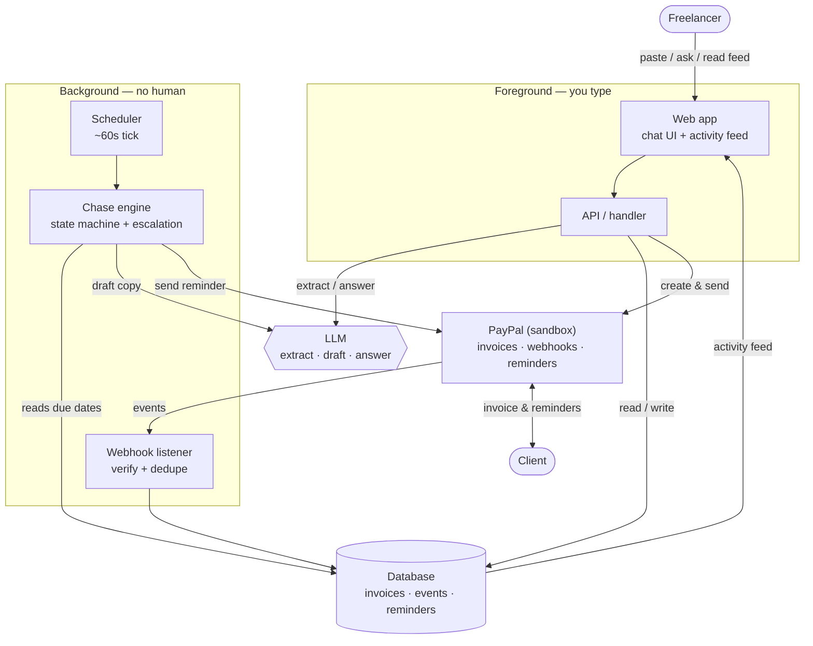
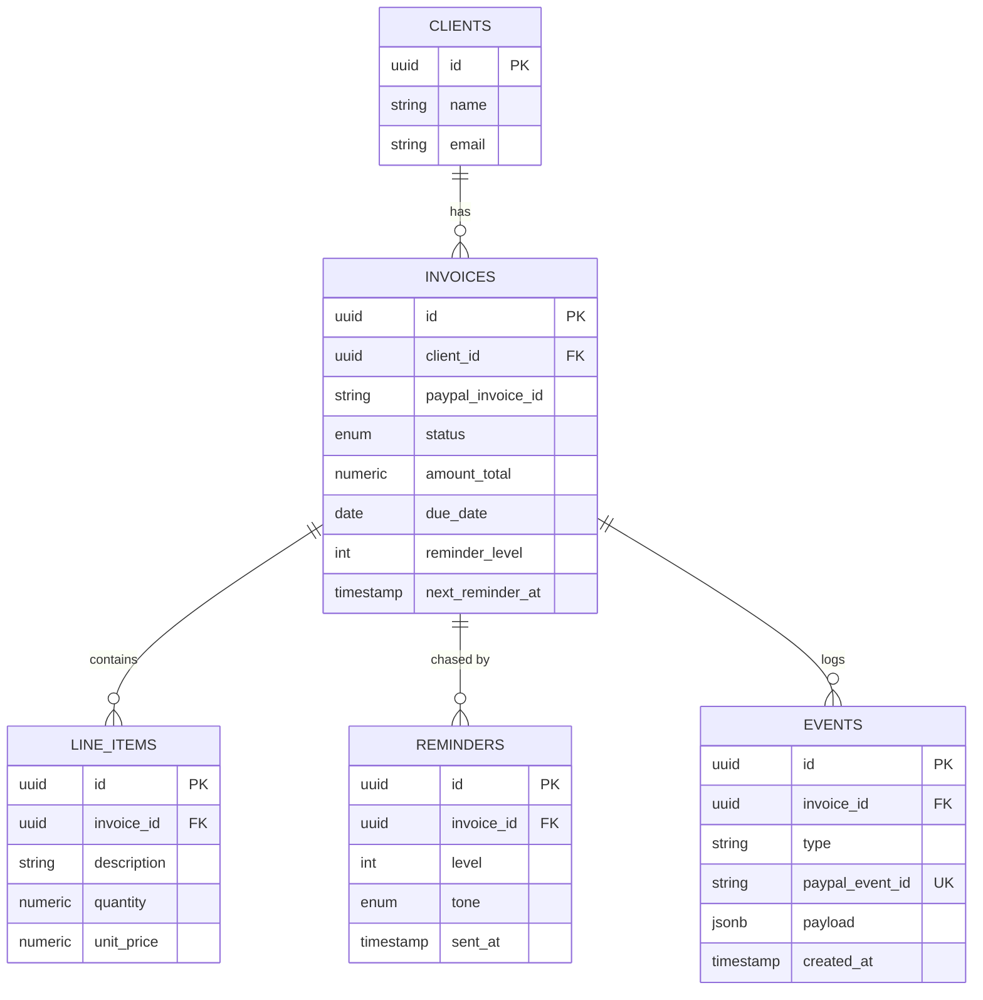
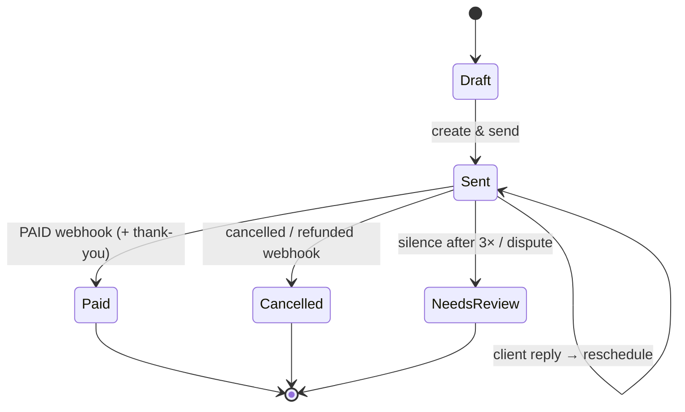

# Get Paid

**An autonomous accounts-receivable agent for freelancers.** Tell it about a job in plain English, and it bills the client, watches for payment, chases late payers on its own escalating schedule, and answers "who owes me?" — so you never have to do the awkward money admin again.

> Tell it → it bills → it watches → it chases → it reports. It already handled it while you were asleep.

Built for **"Build What's Next with PayPal and AI."** It puts AI behind the wheel of payments: the agent *operates* PayPal autonomously rather than just chatting about it.

---

## The problem

Freelancers are great at their craft and hate the money side. Writing invoices is tedious, clients pay late constantly, sending "where's my payment?" reminders feels awkward, and tracking who still owes you is messy. **Get Paid** takes the entire "get paid" loop off your plate and runs it in the background.

## What it does

1. **Scope** — You paste a casual client message (*"Go ahead with the logo + 3 banners, agreed price $500"*). The agent reads it and extracts line items + amount.
2. **Invoice** — It creates and sends a **real PayPal invoice** — no forms.
3. **Watch** — It listens for PayPal webhooks (paid / cancelled / refunded) in the background.
4. **Chase** — If a client is late, the agent **drafts and sends reminders on its own**, escalating in tone over time (friendly → neutral → firm) — with no human in the chat.
5. **Ask** — Anytime, ask in chat: *"Who still owes me?"* or *"How much did Acme pay this month?"* and get an instant plain-English answer from the app's own records.

## Why this isn't "just an LLM wrapper"

The test that settles it: **where does the agency live — in the human, or in the system?**

A wrapper is a loop the *human* drives: you type, the LLM translates to an API call, a result comes back, done. Close the tab and the "agent" ceases to exist.

Here, the loop is a **state machine + scheduler + webhook listener** that runs when nobody is typing and no LLM is even loaded. It's 2am, no human is awake, no chat is open — an invoice crosses its due date, *something* notices it's already sent reminder #1, decides this is reminder #2 (firmer), drafts the copy, sends it through PayPal, records it, and schedules the next check. That "something" is the product. The LLM is a subroutine it calls for a few seconds.

- **It takes real actions**, not just text — it sends real PayPal invoices and reminders and knows whether the client paid.
- **It's event-driven and autonomous** — it reacts to PayPal webhooks *and* runs its own clock, acting with no human present.
- **It has persistent memory** — every invoice, who paid, which reminder level each client is on, across days and weeks.
- **The LLM is ~20% of the system.** Delete the LLM and replace it with templated strings → you still have a working product. Delete the scheduler / state machine / webhook listener → you have ChatGPT. Whatever survives the deletion was the real product.

The LLM touches exactly three spots and **decides nothing with consequences** — it only turns text ↔ text:

| LLM touchpoint | Input → Output |
| --- | --- |
| **Extract** | messy client message → structured line items + total |
| **Draft** | invoice + escalation level → reminder copy |
| **Answer** | plain-English question → query over the app's own data → answer |

Every decision with a consequence (who's overdue, which reminder level, whether to stop and hand back to you) is made by **deterministic code**.

---

## Architecture

The system has two planes. The **foreground** runs when you type; the **background** runs when nobody does. They share one database and one PayPal account — only the trigger differs.

### Foreground path — billing & asking (human-triggered)

You paste a message → the API extracts line items via the LLM → a new invoice is saved → PayPal creates and sends the real invoice to the client. Asking *"who owes me?"* is the same plane but **read-only**: API → LLM → reads the database → answer. Nothing is written.

### Background path — watch & chase (autonomous)

Two independent triggers, both converging on the database, both surfaced in the activity feed:

- **The clock** — the scheduler ticks (~60s), the chase engine finds overdue unpaid invoices, picks the escalation level, the LLM drafts the copy, and PayPal sends it via its `remind` endpoint. No email infrastructure — the reminder goes out through PayPal itself.
- **The event** — the client pays inside PayPal → the `INVOICE.PAID` webhook fires → the listener verifies and dedupes → the invoice is marked paid and a thank-you is sent.

> **Design note:** PayPal does not emit a reliable "overdue" webhook. *Paid* is reactive (webhook); *overdue* is computed by the scheduler from `due_date`. The system therefore has both halves: it reacts to PayPal's events **and** keeps its own clock.

### The Activity Feed

Every autonomous decision is written to an append-only log with its reasoning — e.g. *"02:04 — sent reminder #2 to Acme (firm), because the invoice was 8 days overdue and reminder #1 went unanswered."* It turns the invisible loop into something you (and a judge) can actually see.

---

## Data model

Five tables. `events` is the spine of trust and correctness: every state change leaves a row, and the unique `paypal_event_id` makes PayPal's duplicate webhook deliveries harmless.

`invoices.status` ∈ `DRAFT · SENT · PAID · CANCELLED · REFUNDED · NEEDS_REVIEW`.

## Invoice lifecycle

An invoice only ever lives in one of five states. `SENT` is the only state with internal life — it escalates reminders and reschedules on a client reply **without changing state**.

## How data flows in every condition

| # | Condition | Trigger | Tables written | State |
|---|---|---|---|---|
| 1 | **New invoice** | you paste + confirm | `clients` (if new), `invoices` (→SENT), `line_items`, `events`:`INVOICE_SENT` | → Sent |
| 2 | **Client pays** | `INVOICE.PAID` webhook | `invoices.status`=PAID, `events`:`WEBHOOK_PAID`, `events`:`THANKYOU_SENT` | Sent → Paid |
| 3 | **Reminder fires** | scheduler finds overdue | `reminders`, `invoices.reminder_level`++ · `last_reminded_at` · `next_reminder_at`, `events`:`REMINDER_SENT` | stays Sent |
| 4 | **Client replies "pay Friday"** | reply handling (LLM classifies) | `invoices.next_reminder_at` pushed, `events`:`REPLY_RECEIVED` + `RESCHEDULED` | stays Sent |
| 5 | **Client disputes / "already paid"** | reply handling | `invoices.status`=NEEDS_REVIEW, `events`:`DISPUTE_FLAGGED` | Sent → Needs review |
| 6 | **3 chases, silence** | scheduler sees level 3 exhausted | `invoices.status`=NEEDS_REVIEW, `events`:`ESCALATED_TO_HUMAN` | Sent → Needs review |
| 7 | **Cancelled / refunded** | PayPal webhook | `invoices.status`=CANCELLED/REFUNDED, `events`:`WEBHOOK_CANCELLED` | Sent → terminal |
| 8 | **"Who owes me?"** | you ask in chat | *none* — read-only over `invoices` / `clients` | no change |
| 9 | **Duplicate webhook** | PayPal redelivers | insert into `events` **rejected** by unique `paypal_event_id` | no change (idempotent) |
| 10 | **Demo: simulate overdue** | button | `invoices.due_date` backdated → next tick runs condition #3 for real | stays Sent |
| 11 | **Demo: mark paid** | button | replays a `PAID` event through the real webhook handler → runs condition #2 | Sent → Paid |

Two invariants hold across every row — this is what keeps it correct while running unattended:

- **Nothing changes state without an `events` row.** The log is the source of truth; the feed and the Q&A only read it. If it isn't in `events`, it didn't happen.
- **Writes are idempotent.** Webhooks dedupe on `paypal_event_id` (#9); chases advance `reminder_level` only *after* PayPal confirms the send, so overlapping ticks (#3) can't double-send or skip a level.

The demo buttons (#10, #11) drive the **real** code paths, not mocks — so a 3-minute video exercises exactly what runs in production.

---

## Software / tech stack

| Layer | Choice | Why |
|---|---|---|
| **App** | Next.js (App Router), TypeScript | Frontend + API routes + webhook endpoint in one deploy |
| **Hosting** | Render (persistent Node web service) | A always-on process so the scheduler actually runs |
| **Database** | PostgreSQL (Neon / Render) | Persistent state across days; survives restarts |
| **Scheduler** | `node-cron` (in-process) | The heartbeat — ticks ~60s, finds overdue, chases |
| **AI** | Claude (Anthropic) via the API, structured output | Reliable JSON for extraction; drafting; NL Q&A. Provider-pluggable |
| **Payments** | PayPal Invoicing API + Webhooks + `remind` endpoint | Create/send invoices, receive events, send reminders — all inside PayPal |
| **Agent tooling** | PayPal Agent Toolkit *(optional, foreground chat path)* | "AI operating PayPal via PayPal's own toolkit"; the autonomous loop uses direct REST for determinism |

### The magic moment (demo)

1. Paste a messy client message → the agent creates & sends a real PayPal sandbox invoice.
2. Hit **simulate overdue** → the scheduler treats it as late → the agent drafts and sends an escalating reminder with **no human input**.
3. Ask the chat **"who still owes me?"** → instant answer from the app's own data.

## Privacy & trust (by design)

The agent only sees invoices and clients **created inside the app** — not a full sync of your entire PayPal history. "Who owes me?" is answered from the app's own invoice records. This keeps the scope clean and avoids the "hand your whole financial life to an AI" problem.

## Status

🚧 Early build for the hackathon. This README documents the target architecture and data model; the MVP focuses on the magic-moment loop above, with the Activity Feed and "knows-its-limits" escalation (condition #6) baked into the core, and client-reply handling (conditions #4–#5) as the stretch goal.

## License

To be added (open-source license required by the hackathon — MIT recommended).
