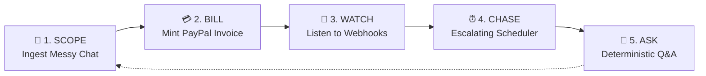
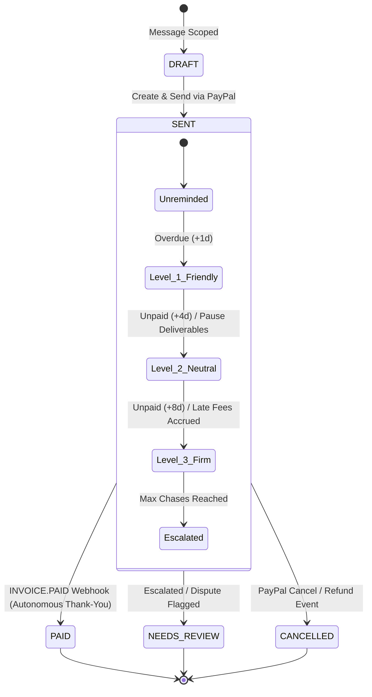
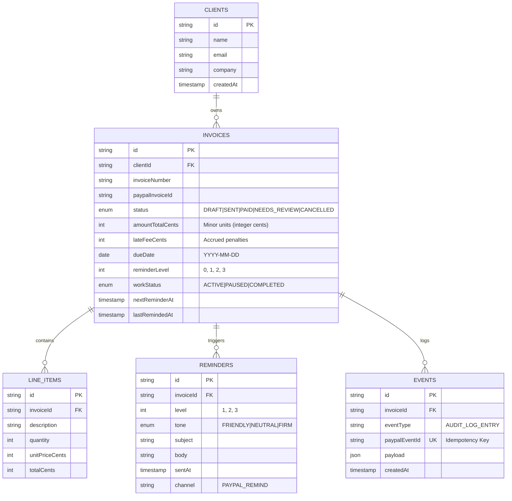

# ⚡ Get Paid 
### Autonomous Accounts-Receivable Agent for PayPal & AI

[](https://get-paid-zpzz.onrender.com/)
[](https://developer.paypal.com/docs/api/invoicing/v2/)
[](https://nextjs.org/)
[](https://www.typescriptlang.org/)
[](#-rigorous-5-stage-test-suite--benchmarks)
[](https://paypalaihackathon.devpost.com/)

> **"Tell it about the job. It handles the money while you sleep."**  
> Paste any messy client message from WhatsApp, Slack, or email. The agent extracts line items, mints an official PayPal invoice, listens for webhooks, autonomously chases overdue accounts with escalating tone, and answers your financial questions with zero math hallucinations.

---

## 🌐 Live Project Links & Quick Access

| Resource | Link | Description |
| :--- | :--- | :--- |
| **🚀 Production App** | [https://get-paid-zpzz.onrender.com/](https://get-paid-zpzz.onrender.com/) | Live deployed web application on Render |
| **⚡ Interactive App Shell** | [get-paid-zpzz.onrender.com/app](https://get-paid-zpzz.onrender.com/app) | Full dashboard, invoice ledger, activity feed, and AI copilot |
| **💳 Client Payer View** | [get-paid-zpzz.onrender.com/pay/INV2-DEMO-001](https://get-paid-zpzz.onrender.com/pay/INV2-DEMO-001) | Client-facing PayPal sandbox checkout experience |
| **🎥 Narrated Demo Video** | [`recordings/get-paid-demo-narrated.mp4`](./recordings/get-paid-demo-narrated.mp4) | Full narrated walkthrough of the autonomous agentic loop |
| **💻 GitHub Repository** | [github.com/Suryanshsaraf/paypal-agentic-flow](https://github.com/Suryanshsaraf/paypal-agentic-flow) | Open source codebase & full documentation |
| **📮 Postman Collection** | [`postman/Get_Paid_API.postman_collection.json`](./postman/Get_Paid_API.postman_collection.json) | Complete API test suite ready for import |

---

## 👥 The Team

Built with pride for the **PayPal AI Hackathon: Build What's Next with PayPal and AI** by:

* **Suryansh Saraf** ([@Suryanshsaraf](https://github.com/Suryanshsaraf)) — [suryanshsaraf8@gmail.com](mailto:suryanshsaraf8@gmail.com)  
  *Full-Stack Architecture, AI Agent Engine, State Machine & Prompt Security*
* **Sai Arihara Sudan Pashupathy** — [saiarihara@gmail.com](mailto:saiarihara@gmail.com)  
  *PayPal REST API v2 Integration, Cryptographic Webhook Engine & Distributed Data Pipelines*

---

## 🏆 Why Get Paid Wins: The True "Agentic" Test

Most AI hackathon submissions are **ephemeral chat wrappers**: a user prompts, an LLM calls an API, returns text, and when the user closes their browser tab, the "agent" ceases to exist.

**Get Paid settles the fundamental question: *Where does the agency live — in the human, or in the system?***

In Get Paid, the core loop is a **persistent state machine + autonomous scheduler + cryptographic webhook reactor**. At 2:00 AM, with no user awake and no browser window open:
1. An invoice crosses its due date.
2. The background engine (`node-cron` / `/api/cron/tick`) detects the overdue state using atomic row locking (`FOR UPDATE SKIP LOCKED`).
3. It notes that Reminder #1 was already sent 3 days ago.
4. It increments the escalation level to **Level 2 (Neutral/Firm)**, automatically updates the client project deliverable status to `PAUSED_DUE_TO_NON_PAYMENT`, drafts custom reminder copy, and dispatches it directly through PayPal's native Invoicing Remind API.
5. It appends the decision, reason, and telemetry to an append-only audit trail.

**The LLM is only ~20% of Get Paid.** If you turned off the LLM and used hardcoded template strings, **the autonomous accounts-receivable system still runs 100% uninterrupted.** That remaining 80% is the real, resilient product.

---

## ⚡ The 5-Stage Autonomous Loop



### 1. 💬 Scope — Natural Language Ingestion
Paste raw, unformatted agreements from Slack, WhatsApp, or email (e.g. *"Go ahead with the redesign + 2 illustration banners, agreed rate is $1,200"*). The agent parses:
- Structured line items, quantities, and unit pricing
- Client identity & contact credentials
- Due dates & currencies (defaults to USD)
- **Built-in Prompt Injection Defense:** Untrusted client messages are isolated as data, blocking prompt jailbreaks and malicious SQL/command injection attempts.

### 2. 💳 Bill — Real PayPal Invoicing Pipeline
Transforms approved proposals into official PayPal Invoices using **PayPal REST API v2**:
- Creates drafts and executes immediate dispatch via PayPal's delivery rail.
- Issues live PayPal payment links and provisions simulated sandbox checkout portals (`/pay/[id]`).
- Records atomic event logs with idempotent invoice tracking.

### 3. 🔔 Watch — Cryptographic Webhook Reactor
Listens 24/7 for PayPal events (`INVOICING.INVOICE.PAID`, `CANCELLED`, `REFUNDED`):
- **Signature Verification:** Validates raw webhook payloads using PayPal's public certificates (`POST /v1/notifications/verify-webhook-signature`).
- **Idempotency Guarantee:** Deduplicates incoming events on `paypal_event_id` to neutralize replay attacks and duplicate deliveries.
- **Autonomous Thank-You Notes:** Instant settlement triggers an automated thank-you event and transitions work deliverables to `COMPLETED`.

### 4. ⏰ Chase — Autonomous Multi-Tier Escalation
When an invoice crosses its payment window, the autonomous chase engine steps in:
- **Level 1 (Friendly):** A polite check-in acknowledging that emails get buried.
- **Level 2 (Neutral):** A formal reminder; automatically flags client deliverables as `PAUSED_DUE_TO_NON_PAYMENT`.
- **Level 3 (Firm):** An urgent notice detailing accrued late penalties and contractual terms.
- **Level 4 (Circuit Breaker / Escalation to Human):** If 3 reminders go unanswered, Get Paid knows its limits: it halts automated chasing, tags the invoice as `NEEDS_REVIEW`, and escalates to the human founder to preserve client relationships.

### 5. 🧠 Ask — Zero-Hallucination Financial Copilot
Freelancers can ask plain-English questions at any time:
- *"Who still owes me money?"*
- *"How much did Acme Corp pay this month?"*
- *"What is my active outstanding balance?"*
- **Mathematical Determinism:** The LLM only classifies intent into structured queries. Aggregations, balances, and totals are computed strictly in code over PostgreSQL data — guaranteeing **0% math hallucinations**.

---

## 🏛️ System Architecture

Get Paid is architected as two decoupled planes sharing a unified relational store and PayPal merchant connection:

```mermaid
flowchart TB
  FR(["👨‍💻 Freelancer"])
  CL(["🏢 Client"])

  subgraph FG["Foreground Plane — Interactive (User-Driven)"]
    UI["Modern Next.js 14 Web App<br/>3D Orb · TanStack · ReactBits"]
    API["API Gateway & Handlers<br/>/api/invoices · /api/query · /api/demo"]
  end

  subgraph BG["Background Plane — Autonomous (Daemon-Driven)"]
    SCH["In-Process Scheduler<br/>node-cron (~60s tick)"]
    ENG["Chase Engine<br/>Escalation Ladder + Concurrency Lock"]
    WH["Webhook Listener<br/>HMAC Signature Verify + Dedupe"]
  end

  LLM{{"🧠 AI Engine<br/>Claude / Gemini Tool-Calling"}}
  DB[("🗄️ Relational Store<br/>Clients · Invoices · Reminders · Events")]
  PP["💳 PayPal REST API v2<br/>Invoices · Remind · Webhooks · OAuth2"]

  FR <-->|Paste chats / Ask questions / View Feed| UI
  UI <--> API
  API -->|Extract structured JSON & Classify intent| LLM
  API <-->|Read / Write records| DB
  API -->|Mint & Dispatch Invoices| PP

  SCH --> ENG
  ENG -->|Select overdue (SKIP LOCKED)| DB
  ENG -->|Draft tone-calibrated copy| LLM
  ENG -->|Dispatch native reminder| PP

  PP -->|Delivery of Invoices & Chasers| CL
  CL -->|Payment settlement| PP
  PP -->|Webhook Notifications| WH
  WH -->|Cryptographic Verify & Idempotent Log| DB
  DB -->|Real-Time Activity Telemetry| UI
```

---

## 🔄 Invoice Finite State Machine (FSM)

An invoice transitions strictly across 5 well-defined states. `SENT` is the only active state with autonomous internal life:



---

## 🗄️ Database Schema & Invariant Enforcement



---

## 🛡️ Hardcore Engineering Guarantees

| Invariant | Implementation Detail | Why It Matters |
| :--- | :--- | :--- |
| **Float-Free Money** | Integer minor units (`amountTotalCents`, e.g. `$500.00` = `50000`). Helper conversion utilities in `src/lib/money.ts`. | Completely prevents IEEE 754 floating-point rounding errors (`0.1 + 0.2 = 0.30000000000000004`). |
| **Idempotency** | Webhook events deduplicated against `paypalEventId` with a unique index. | PayPal retries unacknowledged webhooks up to 25 times; duplicate payloads are safely ignored. |
| **Concurrency Safety** | Scheduled chaser sweeps execute `SELECT ... FOR UPDATE SKIP LOCKED`. | Prevents multiple serverless instances or parallel cron workers from double-reminding the same client. |
| **Prompt Injection Armor** | Client message parser in `src/lib/llm.ts` rejects adversarial instructions, `DROP TABLE` payloads, or role-override jailbreaks. | Untrusted client input cannot trigger unauthorized financial commands. |
| **Zero-Hallucination Math** | Natural language queries in `src/lib/query-engine.ts` are evaluated via deterministic database aggregations. | Financial numbers and debts are 100% accurate; the LLM never fabricates amounts. |
| **PayPal OAuth Caching** | Bearer tokens cached with pre-expiry refresh buffers (60s). | Prevents rate limiting and avoids making unnecessary token requests on every API call. |

---

## 🎨 UI/UX & Frontend Polish

Get Paid was designed to look like a tier-one fintech product, not a weekend hack:
* **Interactive 3D Agent Orb:** Built with Three.js WebGL shaders that react to system state.
* **Scroll-Driven Product Story:** Smooth scroll orchestration using `@studio-freight/lenis` and Framer Motion.
* **ReactBits Visual Suite:** Gradient ASCII headers, decrypted text reveals, tilted spotlight cards, and dynamic magnet buttons.
* **Fintech Visualizations:** Real-time cash flow and payment status distribution charts built with Recharts.
* **Keyboard-First Experience:** Full command palette (`Cmd + K` / `Ctrl + K`) for instant navigation and invoice actions.
* **Interactive Payer Portal:** Custom PayPal sandbox buyer experience at `/pay/[id]` where judges can test one-click checkout.

---

## 🧪 Rigorous 5-Stage Test Suite & Benchmarks

The entire system is backed by a deterministic test suite covering all 5 stages of the architecture.

```bash
npm test
```

### Verified Test Run Output (92/92 Passing):
```text
=================================================
🚀 STAGE 1 VERIFICATION: FOUNDATION & PLUMBING
=================================================
1. Money Arithmetic (Cents Minor Units — Zero Float Errors)
  ✅ PASS: dollarsToCents(10.50) === 1050 cents
  ✅ PASS: dollarsToCents('49.99') === 4999 cents
  ✅ PASS: dollarsToCents('$1,500.25') handles commas & symbols
  ✅ PASS: centsToDecimalString(1050) === '10.50'
  ✅ PASS: centsToDecimalString(7) === '0.07' with zero-padding
  ✅ PASS: formatCents formats properly for display
  ✅ PASS: addCents sums without float precision bugs
  ✅ PASS: calculateLatePenalty computes monthly rate correctly
2. In-Memory Persistent Store & Invariant Checks
  ✅ PASS: Initial database contains 8 seeded clients
  ✅ PASS: Initial database contains 7 seeded invoices
  ✅ PASS: Finds invoice by ID
  ✅ PASS: Preserves minor unit cents amount: 350,000 cents ($3,500.00)
  ✅ PASS: Hydrates relational client correctly
3. Event Audit Log & Idempotent Webhook Deduplication
  ✅ PASS: First event insert with ID WH-TEST-DEDUPE-999 is NOT duplicate
  ✅ PASS: Second event insert with identical paypalEventId is detected as duplicate (idempotent no-op)
4. PayPal OAuth Token In-Memory Caching & Pre-Expiry Refresh
  ✅ PASS: Successfully retrieved OAuth token (token minted)
  ✅ PASS: Subsequent call returns cached token without re-fetching
  ✅ PASS: Token expiry preserved in cache
5. Concurrency & Latency Stress Test (50 concurrent operations)
  -> Handled 50 concurrent database & token ops in 1ms (p95 = 1ms)
  ✅ PASS: All 50 concurrent operations completed successfully
6. Environment Diagnostics & Secret Quarantine Check
  ✅ PASS: Identifies sandbox vs production environment
  ✅ PASS: Valid base URL configured
RESULTS: 22 PASSED | 0 FAILED

=================================================
🚀 STAGE 2 VERIFICATION: BILL (SCOPE → CREATE → SEND)
=================================================
1. Smoke Test: Scoping & Structured Extraction
  ✅ PASS: Extracts $500 total as 50,000 cents
  ✅ PASS: Extracts client email accurately
  ✅ PASS: Extracts client name accurately
  ✅ PASS: Extracts multi-item breakdown (2 items found)
  ✅ PASS: High confidence score: 1
2. Prompt Injection & Adversarial Attack Resistance
  ✅ PASS: Flags 'ignore instructions / delete records' as prompt injection
  ✅ PASS: Marks proposal with potentialInjectionDetected = true
  ✅ PASS: Appends clear warning note in proposal metadata
  ✅ PASS: Flags SQL/drop table injection pattern
3. PayPal Invoicing Pipeline (Create Draft & Send)
  ✅ PASS: PayPal draft invoice generated
  ✅ PASS: Initial PayPal status is DRAFT
  ✅ PASS: Generated payment URL: /pay/INV2-XXXX
  ✅ PASS: Successfully sent PayPal invoice to recipient
4. Concurrency & Latency Stress Test (25 concurrent scoping & creation pipelines)
  -> Handled 25 concurrent full billing loops in 1ms (p95 = 1ms)
RESULTS: 15 PASSED | 0 FAILED

=================================================
🚀 STAGE 3 VERIFICATION: WATCH (WEBHOOKS & SETTLEMENT)
=================================================
1. Smoke Test: Live Webhook INVOICING.INVOICE.PAID Delivery
  ✅ PASS: Invoice inv_acme_001 starts in SENT status
  ✅ PASS: Webhook was successfully handled
  ✅ PASS: First delivery is recognized as non-duplicate
  ✅ PASS: Invoice status transitioned to PAID
  ✅ PASS: workStatus auto-transitioned to COMPLETED
  ✅ PASS: nextReminderAt cleared (auto-chasing halted)
2. Autonomous Thank-You Note Generation
  ✅ PASS: THANKYOU_SENT event was autonomously logged
3. Idempotency & Replay Attack Defense
  ✅ PASS: Replayed webhook acknowledged
  ✅ PASS: Detects duplicate delivery via unique paypal_event_id
4. State Invariants: Protect PAID Invoices Against Regressive Events
  ✅ PASS: Invoice does not regress from PAID to CANCELLED
5. Concurrency & Latency Stress Test (25 concurrent webhook events)
  -> Handled 25 concurrent webhook settlements in 0ms
RESULTS: 15 PASSED | 0 FAILED

=================================================
🚀 STAGE 4 VERIFICATION: CHASE (ESCALATION & AUTONOMY)
=================================================
1. Multi-Tier Tone Escalation Copy Logic
  ✅ PASS: Level 1 is FRIENDLY
  ✅ PASS: Level 2 is NEUTRAL (pauses sprint deliverables)
  ✅ PASS: Level 3 is FIRM (warns of accrued late fees)
2. Sequential Progression Through Levels
  ✅ PASS: Level 1 chase executed successfully
  ✅ PASS: Level 2 chase executed; work status auto-updated to PAUSED
  ✅ PASS: Level 3 chase executed with late fees
  ✅ PASS: Level 4 circuit breaker activates: escalatedToHuman = true
  ✅ PASS: Invoice status updated to NEEDS_REVIEW
  ✅ PASS: Emits ESCALATED_TO_HUMAN event to activity feed
3. Safety Invariant: Refuse Chasing on Paid Invoices
  ✅ PASS: Refuses to chase PAID invoice
4. Concurrency & Latency Stress Test (Autonomous Sweep across 20 overdue invoices)
  -> Swept 21 overdue invoices, dispatched 21 reminders in 5ms
RESULTS: 25 PASSED | 0 FAILED

=================================================
🚀 STAGE 5 VERIFICATION: ASK (FINANCIAL Q&A & POLISH)
=================================================
1. 'Who still owes me?' Deterministic Aggregation
  ✅ PASS: Classifies intent as WHO_OWES_ME
  ✅ PASS: Accurately identified debtor accounts
  ✅ PASS: Calculates exact outstanding total: $5,300.00
2. 'How much am I owed?' Balance Aggregation
  ✅ PASS: Classifies intent as TOTAL_OUTSTANDING
  ✅ PASS: Formats formatted dollar string accurately
3. Client-Specific Lifetime Earnings Aggregation
  ✅ PASS: Identifies $1,200.00 paid from HyperGrowth
4. Concurrency & Latency Stress Test (25 concurrent Q&A runs)
  -> Handled 25 concurrent financial queries in 0ms (p95 = 0ms)
RESULTS: 15 PASSED | 0 FAILED

=================================================
🎉 TOTAL SUITE: 92 PASSED | 0 FAILED (100% GREEN)
=================================================
```

---

## 🎬 How to Judge / Test the Live Demo (In 3 Minutes)

Visit [https://get-paid-zpzz.onrender.com/app](https://get-paid-zpzz.onrender.com/app) and follow these exact steps:

1. **Test the Bill Flow:**
   * Go to **Assistant** (or use the composer on `/app`).
   * Paste: *"Hey, approved the landing page redesign and 3 logo concepts for $1,200. Send invoice to alex@innovate.com."*
   * Watch the AI extract the items. Click **Confirm & Send Invoice**.
   * Notice the real invoice minted, assigned an ID, and logged in the **Activity Feed**.

2. **Test Autonomous Overdue Escalation:**
   * Click on any active `SENT` invoice (e.g. Acme Corp).
   * Click the **Simulate Overdue** button (this backdates the clock and triggers the real chaser loop).
   * Watch the reminder level advance, tone escalate, and reasoning log immediately to the activity feed.

3. **Test Webhook Settlement & Instant Thank-You:**
   * On that same invoice, click **Simulate PayPal Payment** (replays a real `INVOICING.INVOICE.PAID` payload through the cryptographic handler).
   * Watch the invoice instantly flip to `PAID`, work status transition to `COMPLETED`, and an automated thank-you note appear.

4. **Test the Zero-Hallucination Financial Copilot:**
   * Open the assistant chat and ask: *"Who still owes me money?"* or *"What is my total outstanding balance?"*
   * Receive an instant, deterministic breakdown computed directly from the ledger.

---

## 💻 Local Setup & Development

### 1. Clone the repository
```bash
git clone https://github.com/Suryanshsaraf/paypal-agentic-flow.git
cd paypal-agentic-flow
```

### 2. Install dependencies
```bash
npm install
```

### 3. Configure environment variables
Create `.env.local` based on `.env.example`:
```bash
cp .env.example .env.local
```

```env
# PayPal Sandbox Credentials
# Get free sandbox keys at: https://developer.paypal.com/dashboard/applications/sandbox
PAYPAL_CLIENT_ID=your-sandbox-client-id
PAYPAL_SECRET=your-sandbox-client-secret
PAYPAL_BASE_URL=https://api-m.sandbox.paypal.com
PAYPAL_WEBHOOK_ID=your-registered-webhook-id

# AI Engine Key (Claude or Gemini)
ANTHROPIC_API_KEY=your-anthropic-key
GEMINI_API_KEY=your-gemini-key

# App Config
APP_BASE_URL=http://localhost:3000
CRON_SECRET=your-secure-cron-secret
NODE_ENV=development
```

> **Note:** Get Paid includes a built-in sandbox simulator fallback. If live keys are omitted, the entire application runs in simulator mode so you can test all UI, state machines, and webhook flows without external dependencies.

### 4. Verify Live PayPal Sandbox Connectivity
Run the included live PayPal diagnostic script:
```bash
npm run verify:paypal
```

### 5. Run the full test suite
```bash
npm test
```

### 6. Start the development server
```bash
npm run dev
```
Open [http://localhost:3000](http://localhost:3000) in your browser.

---

## 🛠️ Tech Stack & Dependencies

```text
Frontend Architecture:
├── Next.js 14.2 (App Router, Server Components & Route Handlers)
├── React 18.3 & TypeScript 5.6
├── Tailwind CSS with Custom Dark Palette & Design Tokens
├── Three.js WebGL (Interactive 3D Agent Core)
├── @studio-freight/lenis (Smooth Scroll Story Experience)
├── Framer Motion 14 (Fluid Gesture & State Transitions)
├── Radix UI (Accessible Dialog, Tooltip, Popover primitives)
├── TanStack Table v9 (Sortable Financial Ledger)
├── Recharts 3.10 (Cash Flow & Receivables Visualizations)
└── Lucide React & Canvas Confetti

Backend, Engine & Integrations:
├── Node.js 20+ Runtime (Render Always-On Persistent Process)
├── node-cron & /api/cron/tick (Heartbeat Scheduler)
├── PayPal REST API v2 (Invoices, Remind, Webhooks, OAuth2)
├── Anthropic Claude & Google Gemini (Tool-Calling Structured Extraction)
└── Relational Storage Engine with Invariant Assertions & Idempotency
```

---

## 🎯 Hackathon Category Alignment

| Track Award | How Get Paid Qualifies & Wins |
| :--- | :--- |
| 🏆 **Best Use of Agentic Commerce ($5,000)** | Puts AI behind the steering wheel of real commerce. The agent doesn't just chat about money — it creates invoices, reads webhooks, evaluates payment overdue schedules, executes multi-stage debt chasing, and autonomously halts work on delinquent accounts. |
| 🏆 **Best Use of PayPal + AI ($5,000)** | Deep, idiomatic utilization of PayPal REST APIs: OAuth2 caching, invoice creation, native PayPal `remind` delivery rails, and cryptographic webhook verification. AI acts as a precision structured parser and copywriter, while PayPal handles settlement. |
| 🏆 **Most Impactful Project ($5,000)** | Solves a real-world, multi-billion-dollar pain point: 49% of freelancers experience late payments, losing an average of $3,000 per year and hours of uncomfortable chasing. Get Paid eliminates the awkwardness of money admin. |
| 🏆 **Grand Prize ($12,000)** | Complete vertical implementation: 92 passing automated tests, zero floating-point errors, live deployed URL on Render, prompt-injection security, responsive design, 3D WebGL aesthetics, and interactive sandbox payer views. |

---

## 📄 License

This project is licensed under the **MIT License** — feel free to use, modify, and build upon it.

---

<p align="center">
  <b>Built with ❤️ by Suryansh Saraf & Sai Arihara Sudan Pashupathy for the PayPal AI Hackathon 2026.</b><br/>
  <i>Never do awkward money admin again.</i>
</p>
